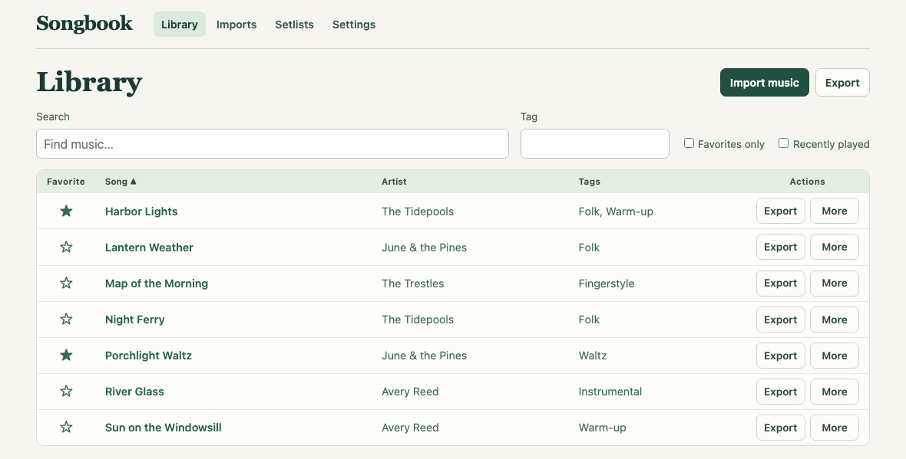
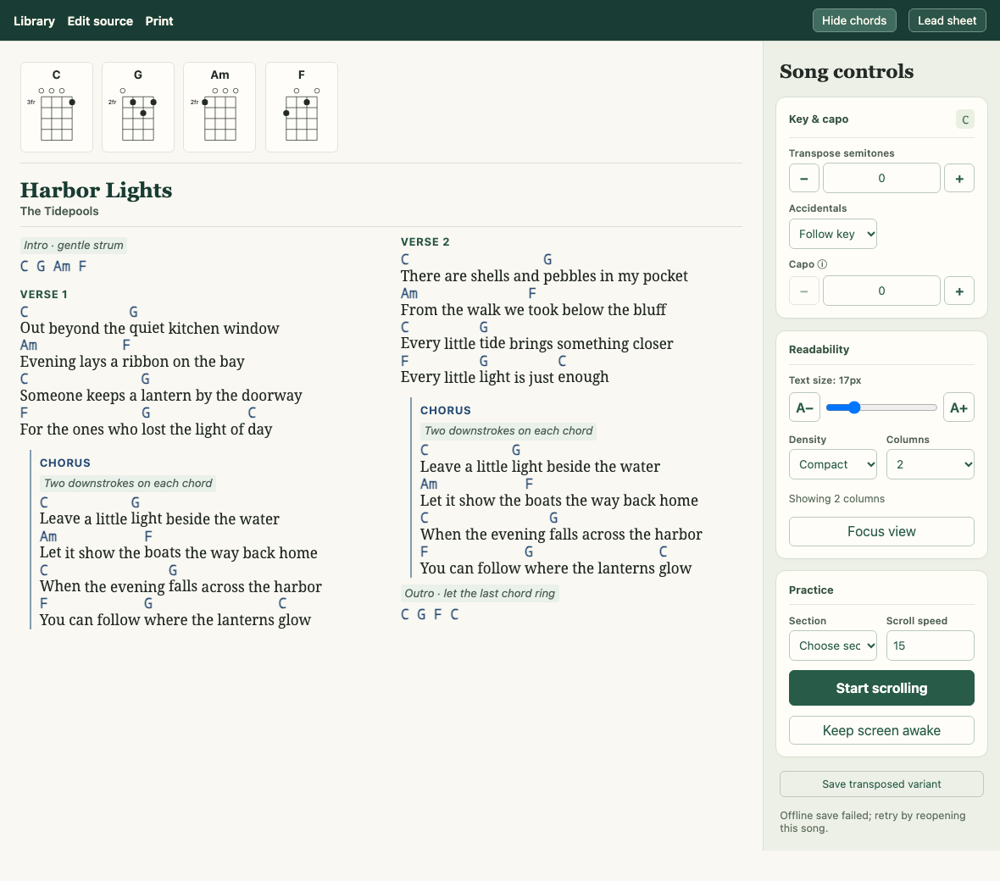
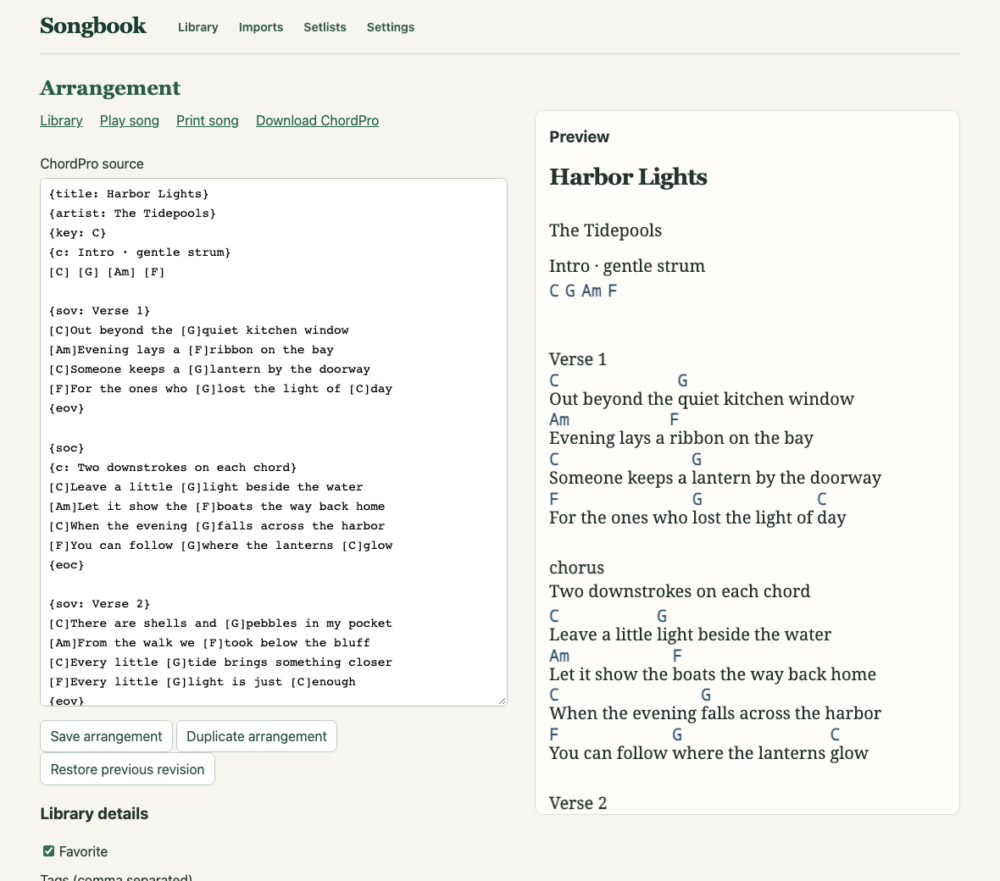
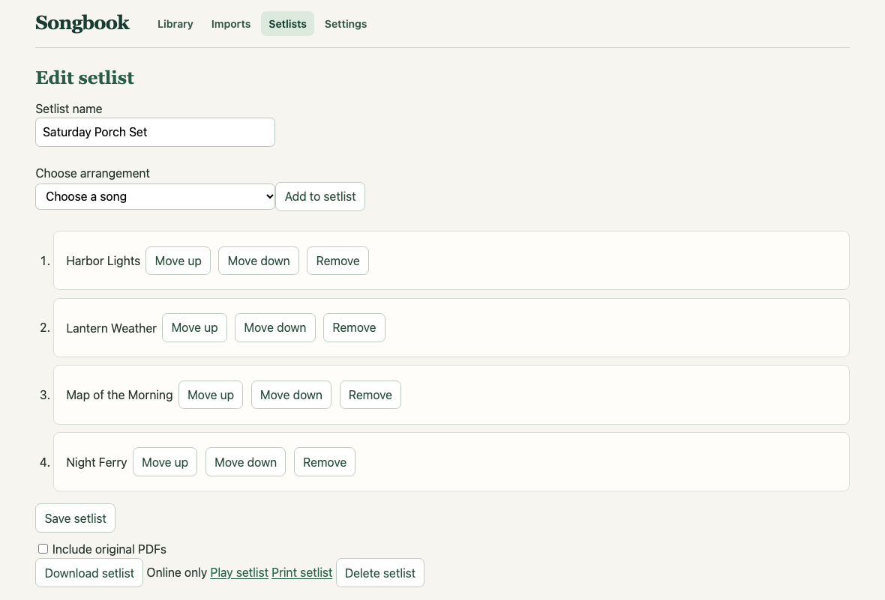
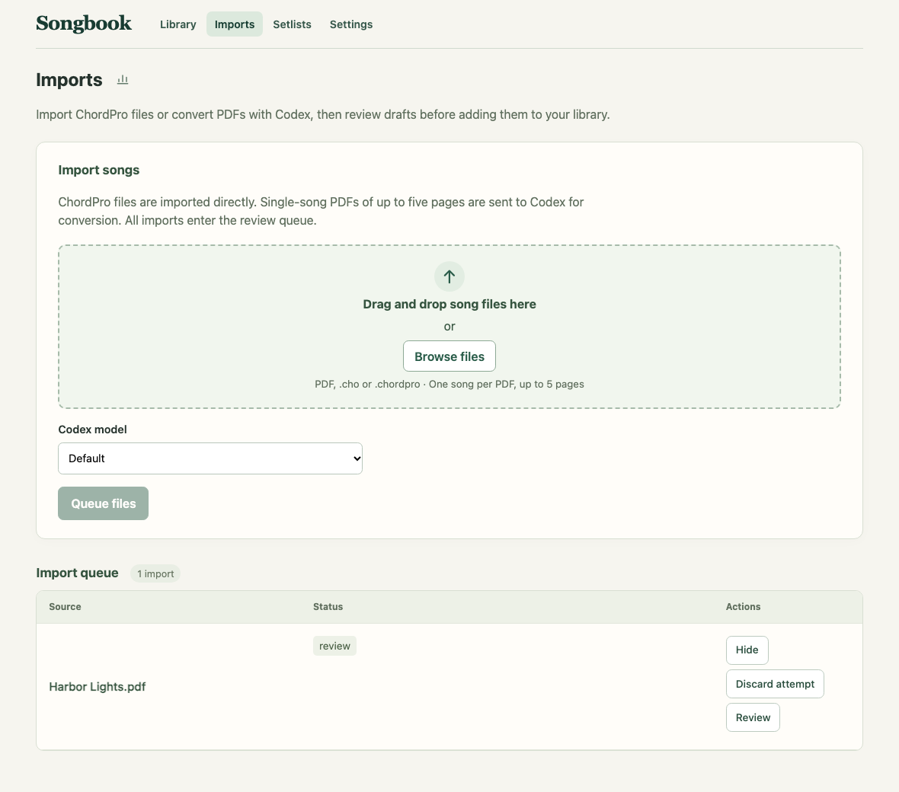

# Ukulele Song Book

Ukulele Song Book is a self-hosted library for keeping songs and chord charts
in one place. Browse your collection, open a song to play, and prepare setlists
or printable copies. The app stores its library locally and supports offline
copies for playing away from a connection.

## Features

- Browse, search, sort, and filter songs by artist or tag. Mark favorites and
  find recently played songs.
- Play ChordPro arrangements with chord diagrams, transposition, capo settings,
  adjustable text and columns, and automatic scrolling.
- Organize songs into setlists and prepare songs or setlists for printing.
- Import PDFs as reviewable drafts with Codex, and keep the original files
  alongside accepted arrangements.
- Download songs for offline use, export your library, and make backups.

## Screenshots

These examples use a demo library.

### Song library



### Player



### ChordPro editor



### Setlists



### Imports



## Run locally with Docker

Install Docker with Compose, then run:

```sh
docker compose build
docker compose up -d
docker compose ps
```

Open [http://127.0.0.1:8000](http://127.0.0.1:8000). The application opens
without a password and is intended for one local operator. The Compose setup
binds to the local machine; keep the library and its originals private. See
[local running](docs/local-running.md) for storage, backups, and configuration.
The [deployment readiness](docs/deployment-readiness.md) notes describe the
remaining work needed for other deployment environments.

## Import songs

In Imports, choose `.cho` or `.chordpro` files to import them directly.
To convert PDFs, sign in to Codex in Settings, choose PDFs and a model in
Imports, then select **Queue files**. Each PDF must contain one song and no more than five pages.
Queuing sends the files to Codex using your subscription. PDF conversion is
experimental: review each draft against the retained original before accepting
it into the library. Live vision conversion fidelity has not been verified.

## Develop locally

Install Python 3.12 or later, Node 22.12 or later, and [uv](https://docs.astral.sh/uv/).
Then install dependencies and start the application:

```sh
uv sync
npm ci
npm run build
export SONGBOOK_LIBRARY_ROOT="$HOME/songbook-data"
uv run songbook serve --host 127.0.0.1 --port 8000
```

Start the import worker in a second terminal with the same library root:

```sh
uv run songbook worker
```

For frontend development, run `npm run dev` separately and open the loopback URL
it displays. Vite proxies API requests to port 8000. Keep the development
server bound to the local machine and keep the library directory outside version
control. It contains imported originals and arrangements.

The project uses these local checks:

```sh
uv run pytest
npm run typecheck
npm run build
npm run check:api
npm exec playwright test
```

Install Playwright's Chromium before running browser tests. Those tests start
disposable local services with synthetic data. Use `npm run generate:api` to
regenerate the API contract.
